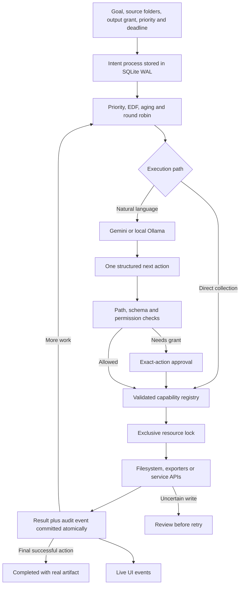

# IntentOS working model

IntentOS manages a user goal as a durable userspace process. It runs on the host OS, with a React interface and Python service at `http://127.0.0.1:8765`. It is an agent runtime that applies OS process-management ideas; it does not replace the Windows or Linux kernel.

## Architecture

The process record contains a UUID, original goal, state, priority, deadline, provider, allowed roots, selected search roots, selected output folder, scopes, output permission, pending action, action ID, observations, completed checkpoints, attempts, execution budget and timestamps. Provider selection is pinned when the goal is admitted. Existing local tasks remain local even after Gemini becomes the default for new tasks.

## 1. Collect related files without disturbing originals

For the fastest path, choose **Gather related files · no AI needed**, enter topic keywords, select source folders, and run. This creates a validated `files_collect` action directly. The UI uses a descriptive new workspace folder when no destination is entered. Ordinary natural-language requests can ask Gemini or Ollama to choose the same capability.

**Save in folder** selects a different base location, such as `D:\meeting`. Existing base folders are accepted and missing base folders are created on saving. Collections get a new subfolder; summaries get a new filename. The chosen folder is added to this goal's grants after copying its search-root list, so it is not searched simply because it is an output destination. No parent drive is implicitly granted. Both planners receive `output_folder`; relative output destinations are normalized against it before validation and approval. The grant and chosen folder survive restart. OS write permissions, credential/private-state exclusions, and existing-output preservation still apply.

1. Resolve every path against the goal's granted roots. The workspace may be granted for output without being selected for search.
2. Walk selected source folders. Whole-computer mode expands to mounted Windows drives or `/` on Linux and prioritizes readable personal folders.
3. Skip hidden paths, credential files, private runtime state, OS-managed directories, application caches, symlinks and directory junctions during discovery.
4. Match Unicode topic phrases at word boundaries against filenames and extracted text. Spaces preserve phrases; commas separate alternatives. `operating system` cannot match `system` alone, and `AWS` cannot match `claws`. Underscores/dashes and simple final-word plurals are supported. Filename hits rank higher. No embeddings or per-file AI calls are used; incidental mentions can still produce false positives. Full instructions containing destination paths are rejected in direct mode, before a task is created.
5. Reuse extracted text from SQLite when canonical path, modification time and size match. Changed files are re-extracted.
6. Reject an existing destination directory. Create `files/` under a new collection folder and copy matched files with exclusive creation.
7. Resolve duplicate filenames with a source-path hash suffix. Compute SHA-256 while copying; verify the source's timestamp/size before copying and timestamp afterwards.
8. Update `manifest.json` after each completed copy. It records original path, copy path, relevance evidence, hash and scan coverage. Package the copies and manifest as `collection.zip`.
9. Checkpoint the result. The UI shows actual copied count, cache hits, scan coverage, destination and download link.

The operation never moves or edits source files. A failed copy can leave a partial destination and manifest; the kernel enters REVIEW and does not blindly replay it. A no-match result creates no empty collection folder. Existing destinations are always rejected.

### Search coverage

Search reads the first 16,000 extracted characters of supported documents up to 10 MB. Larger or unsupported files can match by name up to 100 MB. Supported extraction includes text/code, PDF, DOCX, PPTX and XLSX. There is no OCR, archive-content search or guaranteed semantic understanding. Keyword matching may include false positives and miss synonyms not in the query.

Scans use a durable SQLite queue and continue automatically until the selected sources have been visited and supported contents checked. Filename discovery proceeds breadth-first across the selected roots before content extraction starts, so a slow early PDF cannot prevent discovery on later drives. A scheduler batch handles up to 250 queued items or roughly two seconds of work. A single directory enumeration, document extraction or OS I/O operation can take longer; pause/cancel applies at the batch boundary. There is no total 20-second, 50,000-entry or 1,000-match cutoff. The UI shows discovery/extraction phase, files discovered, contents checked, cache hits and provisional matches. Remaining counts cover known queued items and may grow; no misleading whole-disk completion percentage is shown.

Scan progress is separate from a completed capability checkpoint. The pending action retains its identity while scanning, with no extra model calls. The queue and counters commit before yielding; interrupted read-only scans resume from that queue after restart. The scan is marked complete before copying starts. A crash during copying still enters REVIEW because the filesystem effect may be uncertain. Prior generated collection folders (identified by their manifest, files folder and archive) are skipped to avoid repeatedly gathering copies. Files unreadable or unsupported for extraction retain filename matching when possible. Collections are limited to 500 MB. This remains an extraction cache and on-demand scan, not an always-running whole-disk search daemon.

## 2. Summarize a topic or a collection

Use **Ask anything** and choose an output format or state it in the request. For example:

> Gather my cloud computing project files into a new meeting folder, then summarize what those files say and save a PDF brief.

The model chooses one next action at a time. `files_collect` returns excerpts and paths; `files_find_related` provides context without copying; `files_read` extracts more detail when needed. `research_topic` concurrently queries Wikipedia, Crossref and Open Library for source URLs, snippets and bibliographic metadata. It reports provider failures and does not represent metadata as a full paper. Generic knowledge summaries can be generated directly, saving a network research step. Source-based requests should use observed source material and keep citations in the document.

`document_export` receives the complete generated content, title and new destination path. It writes a real format-specific file:

| Extension | Output |
| --- | --- |
| PDF | Paginated document with headings, paragraphs and page numbers |
| DOCX | Word document with headings and bullet paragraphs |
| PPTX | Widescreen slides with text split across pages |
| XLSX | Summary sections in wrapped text rows, with formulas disabled |
| TXT / MD | UTF-8 text / Markdown |
| HTML | Standalone escaped document without external scripts |
| CSV | Section rows with spreadsheet-formula escaping |
| JSON | Title and structured section array |
| RTF | Unicode rich text |
| ODT | OpenDocument text package |
| EPUB | EPUB 3 package with navigation and metadata |
| ZIP | Archive containing the Markdown summary |

Exports preserve existing files: the writer creates a temporary file, flushes it and publishes it with an exclusive hard link. Filesystems without hard-link support produce an error rather than risking an overwrite. These are prose-oriented exporters, not general conversions of arbitrary media, spreadsheet analysis, chart generation or pixel-perfect document reconstruction. Unsupported extensions are rejected. The PDF text-editing and PDF merge capabilities remain separate.

## 3. Permissions and entire-computer access

**Connections → Accessible folders** configures available paths. Each goal receives only its selected roots and scopes. **Entire computer · accessible files** grants mounted roots for that goal; it uses the existing OS account and does not run as administrator or bypass OS permissions. Exclusions still apply. Explicitly selected roots can be inside an otherwise excluded ancestor, but excluded descendants remain blocked. Runtime state and credential files remain blocked regardless of root selection.

The visible **Allow this goal to create new collections and reports automatically** checkbox is a narrow grant for `files_collect` and `document_export`, both of which refuse existing destinations. It does not grant arbitrary writes, moves, sends or calendar changes. Those require approval of the exact pending action ID and normalized arguments. Revoking or denying one action is respected by the planner.

Gemini receives the goal, bounded observations, relevant excerpts and granted path names; file execution stays local. Ollama receives the same class of task context on loopback and rejects cloud-backed model aliases. There is no silent provider fallback. The direct collection path sends nothing to an AI provider.

The Gemini key and Google OAuth tokens live in the OS credential store, namespaced by the runtime directory. They are never included in the model's tool catalog or observations. Gemini uses a fixed HTTPS endpoint, an API-key header, no proxy forwarding or redirects, bounded responses, and sanitized errors. Source extracts and task history remain in private local runtime databases; removing a folder from future grants does not purge historical caches automatically.

## 4. OS concepts implemented

| Concept | Executing implementation |
| --- | --- |
| PCB / process table | Durable per-intent records in `kernel.sqlite3` |
| Scheduling | One decision/capability per cooperative quantum; aging, near-deadline EDF, priority and round robin |
| Concurrency | Three workers; exclusive named locks for planner, filesystem and service resources |
| Least privilege | Per-goal roots/scopes, validated schemas and narrowly scoped output grants |
| Resource arbitration | One lock acquired per quantum; coarse filesystem serialization avoids conflicting tool writes |
| Checkpointing | Task state and audit event commit in one SQLite transaction after each decision/completed action |
| Recovery | Completed steps retained; retryable reads/planning use backoff; uncertain writes require review |
| Interrupts | Pause/cancel apply at a safe boundary after any in-flight effect is recorded |
| IPC | Typed capability dispatch and authenticated HTTP APIs; no arbitrary shell capability |
| Observability | SSE stream exposes actual state, pending actions, locks, artifacts and audit events |

This scheduler is cooperative and deadlines are best effort. A long in-flight model call can delay another goal needing the same planner lock. There is no cgroup, container or hostile-process isolation, and canonical-path checks cannot eliminate every race with another program modifying the filesystem. SQLite cannot atomically commit external email or filesystem effects; the system does not claim exactly-once delivery.

## 5. Low latency strategy and live evidence

- Direct gathering removes the AI call entirely.
- One high-level collection call handles discovery and copies, avoiding a model round trip per file.
- Cached text extraction avoids reopening unchanged documents on later searches.
- A final tool action can set `complete_after=true`; completion is produced from its successful result instead of asking the model to narrate it again.
- Gemini context includes a scoped tool catalog, bounded recent observations and artifact checkpoints. Large lists are abbreviated with explicit counts.
- Research APIs run concurrently. Collection results sent over SSE are abbreviated to 50 files while the complete provenance manifest remains downloadable.

Live tests on this Windows machine on **9 October 2026**, using only synthetic source files:

| Workflow | Wall time | Successful model decisions | Result |
| --- | ---: | ---: | --- |
| Direct topic collection | 0.378 s | 0 | Three relevant files copied; irrelevant file excluded |
| Gemini topic collection | 26.849 s | 1 | Three files copied; includes retry after a Google HTTP 503 |
| Gemini PDF summary | 12.755 s | 1 | Real readable PDF; downloaded bytes matched saved artifact |
| Gather + source-based meeting brief | 28.135 s | 2 | Collection plus Markdown; actual budget and review date included |
| Three-provider public research | 1.77 s | 0 | Eleven results from Wikipedia, Crossref and Open Library |

Every original source's SHA-256 stayed unchanged. The PDF was rendered with Poppler and visually checked. These small-fixture measurements are not whole-disk benchmarks or a service-level guarantee. Provider latency, retries, quotas, folder size and document extraction affect wall time.

Reproduce with `python scripts/workflow_live_test.py` and `python scripts/workflow_live_test.py --combined-only` while the app runs and a Gemini key is configured. These are opt-in live API calls. Reports from this run are under `storage_test/live-workflows-20261009-000318/verification.json` and `storage_test/live-workflows-20261009-000619/verification.json`; they contain synthetic fixtures only and are ignored by Git.

## References and extension points

[OpenIntentOS](https://github.com/OpenIntentOS/OpenIntentOS) informed the provider-adapter and capability-registry design. The [public-apis directory](https://github.com/public-apis/public-apis) is a discovery reference, not a promise that every listed service is free or integrated. No external repository was installed or copied into this project.

Add a capability in `services/capabilities.py` with its parameter schema, scope, side-effect flag, handler and resource identity. Planners receive the registry automatically. Keep secrets outside tool parameters and distinguish metadata from downloaded content. Add regressions for path containment, actual outputs, approvals and recovery before making a new tool available.

Gemini uses Google's [REST generation API](https://ai.google.dev/api/generate-content) and configurable [Flash-Lite model](https://ai.google.dev/gemini-api/docs/models/gemini-3.5-flash-lite). Free-tier quotas and availability are governed by [Google's current pricing](https://ai.google.dev/gemini-api/docs/pricing). Ollama remains an explicit local option.
