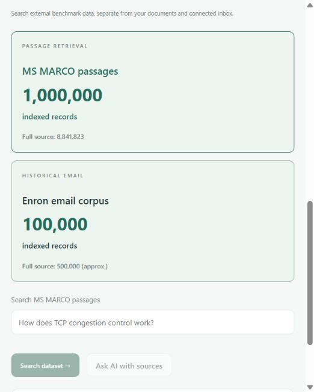

# IntentOS
## Review 2: Methodology, Implementation and Initial Results

**A userspace intent kernel that schedules, authorises, and recovers user goals as first-class processes.**

Aligned with the supplied Review1_OS.pdf | 16 October 2026

### Team members

| Name | Register number |
| --- | --- |
| Santhan Sai Thota | 24BCE0959 |
| Saranya Gullapalli | 24BCE2343 |
| Ruthvika Revadala | 24BAI0240 |

### Project continuity

Review 1 identifies the missing managed execution entity for a user's goal. A goal such as preparing for a meeting crosses Calendar, Files, Maps and Mail, but must retain one identity, a permission boundary, a scheduling position and a recovery checkpoint. Review 2 reports the implementation of that Intent Process abstraction and the remaining differences from the proposal.

The research focus remains **scheduling, authorisation and recovery**. RAG, OCR, document uploads and the redesigned interface are supporting capabilities: they improve the evidence available to a process without replacing the intent kernel as the project's central contribution.

### Review 2 scope

This document maps all nine Review 1 objectives to implementation evidence, retains the five-layer architecture and eight kernel components, explains the process control block and lifecycle, and distinguishes the proposed scheduling rule from the policy currently running in the prototype.

It also documents the implemented technology stack, programming languages, installation procedure, configuration, API and storage design, and screenshots of working outputs. Sections 4-5 cover implementation; section 9 presents visual evidence; section 10 records validation results.

The prototype runs as ordinary software on Windows. It leaves the host kernel unchanged and provides best-effort cooperative scheduling, not hard real-time execution. Recorded test and retrieval measurements are preliminary evidence; they do not establish broad performance or patent novelty.

<!-- page -->
# Continuity with Review 1

The objectives below follow section 4 of the supplied first review. “Implemented” refers to the stated prototype mechanism; it does not imply that every property has been proven under arbitrary workloads.

| Review 1 objective | Review 2 implementation and status |
| --- | --- |
| 1. Intent Process and PCB | Implemented: unique ID, goal, state, priority, deadline, grants, pending action, completed results and durable history. The plan is incremental rather than a complete pre-admitted list. |
| 2. Goal to ordered capability calls | Implemented with refinement: Gemini/Ollama proposes one next action after observing prior results. The registry validates names and argument schemas. A full plan is not fixed before admission. |
| 3. Admission and per-goal authorisation | Partially aligned: explicit scopes, paths, attachment grants and action approvals are enforced. Minimal permissions are not automatically derived from an entire plan. |
| 4. Unified effective-deadline scheduling | Not yet identical: the current scheduler uses a starvation branch, a near-deadline branch, and a priority/round-robin branch. The proposed single effective-deadline rule remains an implementation gap. |
| 5. Registry execution and checkpoints | Implemented: named capabilities, no general planner shell, validated dispatch and committed tool results with audit records. |
| 6. Resume without repeating completed work | Implemented: completed checkpoints remain available; interrupted reads can retry. Uncertain external writes require reconciliation rather than automatic replay. |
| 7. Explicit external effects | Implemented with service limits: actions are checked against the user's request/approval; uncertain outcomes enter review. Remote sends cannot be atomically committed with local SQLite. |
| 8. Unchanged host kernel | Implemented on the demonstrated Windows host. IntentOS uses normal files, threads and networking; Linux execution was not validated in this review. |
| 9. Resistance to manipulated inputs | Boundary checks implemented: document text is untrusted, unknown capabilities and out-of-grant paths are rejected. Exhaustive prompt-injection resistance is not established. |

### What the extensions contribute

RAG supplies scoped evidence to objectives 2 and 9. Upload roles clarify the process's inputs. Completion checks add observable criteria to objectives 5 and 6. Process controls and the workflow view expose objectives 1, 4 and 6. These extensions serve the existing project objectives rather than introducing a separate chatbot project.

<!-- page -->
# 1. Finalized system architecture

The architecture retains Review 1's five layers: User, Intent Interface, Intent Kernel, Services and Host OS. The eight kernel components are logical responsibilities, not eight isolated operating-system processes. React and the loopback API form the interface boundary; the Python runtime, planner and capability registry implement the kernel responsibilities. SQLite stores the PCB, results and checkpoints.

:::layers

**Figure 1. Five-layer architecture continued from Review 1.** Services execute only through the validated registry. RAG and OCR extend the Files service. Embeddings run locally; when Gemini is selected, the goal and needed excerpts are sent to Gemini. The host OS remains the execution substrate.

### State and trust boundaries

- A process records its goal, priority, deadline, read grants, selected search roots, output folder, attachments, prerequisites, pending action, checkpoints, and answer.
- Uploads are copies in a private runtime directory. Attaching a file grants that intent access to that exact upload, not to every uploaded file.
- Retrieval filters authorized paths and excludes changed/deleted documents before ranking passages. The local index is application data, not an encrypted multi-user database.
- File contents and retrieved passages are treated as evidence. They cannot create permissions or authorize external actions.
- Pending writes and uncertain external outcomes retain explicit review states. A checkpoint confirms a recorded result; it does not make every remote API exactly-once.

<!-- page -->
# 1.1 Intent Process and lifecycle

Review 1's process control block remains the unit of management. The current runtime represents it as a persistent record and stores each committed capability result alongside its audit event.

| Review 1 PCB field | Current representation |
| --- | --- |
| Identity and goal | id and goal; selected AI provider is retained for the process. |
| Priority and deadline | LOW/NORMAL/HIGH priority and an optional absolute timestamp with timezone. |
| Plan | pending next action, completed steps and history. No immutable complete-plan field is generated at admission. |
| Resource list and grant | scopes, roots, search_roots, output_folder and attachments; the next action determines its resource lane. |
| Results and checkpoint | steps contain committed outputs; pending and history preserve the next operation and relevant observations. |
| Lifecycle state | state, retries, timestamps and cooperative pause/cancel flags. |

### Mapping the proposed seven-state lifecycle

| Review 1 state | Implemented interpretation / refinement |
| --- | --- |
| NEW | Input validation occurs during submission; accepted ordinary goals start READY. Invalid submissions are rejected without a durable NEW process. |
| READY and RUNNING | Eligible work is selected for one planning decision or one capability call, then yields at a checkpoint boundary. |
| WAITING | No single WAITING state represents resource contention. A ready process stays queued until a resource or prerequisite becomes available. WAITING_INPUT represents a necessary user reply. |
| RECOVERY | Retryable failures preserve results and use bounded backoff. |
| COMPLETED | A useful final answer or successful final action satisfies the applicable completion checks. |
| FAILED | Present as a terminal category, but ordinary exhausted retries commonly become BLOCKED so the user can resume or replan. This differs from the proposed automatic FAILED transition. |

Additional states include APPROVAL, REVIEW, PAUSED and CANCELLED. REVIEW identifies an uncertain external effect; it is not proof that the external action failed. These additions make interaction and recovery explicit while preserving the goal's identity.

<!-- page -->
# 2. Detailed methodology

### Intent admission and interpretation

Review 1's conceptual pipeline is Understand -> Plan -> Admit -> Authorise -> Schedule and run -> Complete or recover. The prototype refines its order: it admits a goal with explicit grants, then interleaves planning, validation and execution at each quantum. It does not claim to prevalidate a complete immutable plan.

The composer accepts a goal, optional attachments, selected source folders, output preferences, priority, and prerequisites. A Source attachment supplies factual material. A Reference attachment supplies headings and structural style. The planner is instructed to read references before drafting, preserve their order, and identify missing evidence rather than inventing results. This is structure-guided drafting, not pixel-perfect template reproduction.

### Evidence acquisition

Focused file search first applies folder and date constraints and excludes common tool and nested project folders by default. Comprehensive assessment summaries use folder inventory and complete reads. Question answering can use retrieval-augmented generation [17] with the local index: BM25 retrieves lexical matches, a local embedding model retrieves semantic matches, and reciprocal rank fusion combines their ranks [18].

### Scheduling and execution

The current policy first serves eligible intents waiting at least 30 seconds, then deadlines less than 12 hours away, and otherwise priority with checkpoint rotation. Section 3.1 distinguishes this implementation from Review 1's proposed unified rule. A dependent intent becomes eligible only after all prerequisites complete. Configurable planning and file-read limits operate within a total dispatch limit. Independent reads can run concurrently; file writes exclude readers. A read-many batch reserves the read lane so nested pools cannot multiply the configured capacity.

### Validation and recovery

Observable checks verify required attachment coverage, requested nonempty line counts, listed assessment coverage, and the use of known citation markers. A rejected plan returns feedback for correction before a relevant final action. These checks do not establish semantic truth or guarantee that every claim is supported. Transient failures preserve checkpoints and retry within a bounded policy; persistent failures become visible for recovery.

# 3. Algorithm and flowchart

:::flow

**Figure 2. Input to output flow.** At each checkpoint the process releases its resource and returns to the scheduler. Completion requires both a useful answer or committed output and the applicable observable checks.

<!-- page -->
# 3.1 Scheduling: proposal and implementation

Review 1 objective 4 specifies **earliest effective deadline first, priority as tie-breaker, and aging**. Its section 8.5 also says “Primary order: first in first out”, which conflicts with that objective. This review uses objective 4 as the intended policy and records the contradiction rather than repeating it as one coherent algorithm.

### Target rule retained from Review 1

effective_deadline = absolute_deadline - aging_credit

Among eligible processes, the intended order is increasing effective deadline, then decreasing priority, with stable arrival order for remaining ties. Before implementing this exact rule, the design must specify the aging-credit rate, treatment of goals without deadlines, and interaction with prerequisites and unavailable resources. These details are not completely defined by the supplied first review.

### Policy currently implemented in Runtime._choose

- Filter to READY/RECOVERY intents whose retry time has arrived, prerequisites have completed, and resource capacity is available.
- If any eligible intent has waited at least 30 seconds, select the one queued longest.
- Otherwise, consider intents with deadlines less than 12 hours away; select earliest deadline, then least recent dispatch.
- Otherwise, select highest priority, then least recent dispatch, then creation time.
- Execute one model decision or one capability call and release the resource after the quantum.

This is a best-effort policy with a discrete starvation guard. It does not calculate an aging-credit-adjusted deadline, and the near-deadline branch does not use priority as its tie-breaker. Existing tests confirm examples of the implemented policy; they do not establish conformance to the proposed formula or deadline guarantees.

### Recovery and admission refinements

Review 1 proposes plan-derived grants and a fixed plan at admission. The current system enforces user-selected scopes, file paths and approved actions at dispatch, while permitting subsequent model decisions within that boundary. A read failure can retry; an uncertain write enters REVIEW; exhausted retries usually become BLOCKED. These are disclosed design refinements, not evidence that the complete original admission and lifecycle specification has been implemented.

### Alignment work still required

Formalise the missing scheduling parameters, implement and test the unified comparator, and decide whether to adopt complete-plan admission or retain explicitly bounded incremental planning. Keep those decisions in the system specification before claiming full conformance with objectives 2-4.

<!-- page -->
# 4. Module-wise implementation

The eight components below preserve the names and responsibilities in Review 1 section 9. Several share the same Python module; this is a logical decomposition.

| Kernel component | Implementation and evidence |
| --- | --- |
| Understanding | Goal, selected context and model interpretation in planner/router.py and planner/agent.py. A separate complete structured-intent compiler is not yet implemented. |
| Planner (hybrid) | Gemini/Ollama proposes next actions; services/capabilities.py validates tool names and schemas. Prompt and schema failures are surfaced without dispatch. |
| Process manager | intent_kernel/runtime.py creates and persists the PCB, dependencies and lifecycle transitions; UI exposes status, priority and controls. |
| Permission manager | Registry validation, per-goal scopes and path checks, exact upload grants and action approvals. Unknown tools and out-of-scope paths are rejected. |
| Scheduler | Runtime._choose orders eligible goals using the current branching policy. Section 3.1 records the remaining difference from effective-deadline ordering. |
| Resource and lock manager | Resource lanes and bounded read/model capacity. One scheduler-managed lane is reserved per dispatch; file writes exclude readers. No general deadlock detector or priority inheritance is claimed. |
| Recovery manager | SQLite checkpoints, bounded retries, restart handling and REVIEW for uncertain writes. Completed tool results are retained. |
| Service registry | Named file, network and connected-service capabilities; dispatch-time checks; no general-purpose shell exposed to the planner. |

### Supporting services and interface extensions

Uploads, reference roles, document readers, local RAG, OCR and output checks strengthen the Files service and evidence flow. Searchable history, the workflow view and process controls expose the PCB and audit trail. They do not bypass the permission manager or become a replacement for the kernel.

### Interaction between modules

A reference-based draft demonstrates the interaction: two uploads become explicit process inputs; the planner chooses a parallel read; the runtime validates both paths; each returned document retains provenance; the next model call sees both sources; completion checks require their coverage; the UI presents the formatted draft and the two read branches.

This composition is the project’s implementation focus. Checkpoint recovery and retrieval-augmented generation are established research techniques [3, 17]. A claim that this is a new invention requires a separate, systematic prior-art assessment. No such claim is established by this prototype.

<!-- page -->
# 5. Technologies and tools used

| Layer | Technology used in this implementation |
| --- | --- |
| Runtime | Python 3.14.6 on Windows 11, threading and bounded thread pools |
| Persistence | SQLite transactions, WAL mode, FTS5 full-text search |
| Interface | React 18, Vite 5, CSS variables, responsive layouts, server-sent events |
| AI planning | Configured Gemini provider; optional local Ollama planner |
| Local embeddings | Ollama API with nomic-embed-text; task-specific query/document prefixes |
| Extraction and OCR | Python document readers, bounded XML extraction, PyMuPDF 1.28.2, local English Tesseract data |
| Integrations | Google OAuth and Gmail/Drive/Calendar/Maps APIs through existing adapters |
| Verification | Python unittest, Node test runner, production build, live browser inspection |

### Programming languages and their responsibilities

| Language / representation | Use in the project |
| --- | --- |
| Python | HTTP server, intent runtime, scheduling, permission checks, AI adapters, extraction, retrieval, Google integrations and evaluation scripts. |
| JavaScript with JSX | React components, state updates, composer validation, navigation, workflow views and API requests. |
| CSS and HTML | Responsive presentation, theme tokens, accessibility preferences and the Vite HTML entry point. |
| SQL | SQLite process/event persistence and FTS5 queries for local documents and public corpora. |
| JSON | API payloads, tool argument schemas, settings, stored process records and benchmark reports. JSON is a data format, not an execution language. |

### Dependency declarations

requirements.txt declares psutil >=5.9,<8; keyring >=25,<26; pypdf >=6.1,<7; PyMuPDF >=1.24.2,<2; reportlab >=4,<5; python-docx >=1.1,<2; python-pptx >=1,<2; and openpyxl >=3.1,<4. These are allowed installation ranges, not a fully pinned environment snapshot. The frontend declares React/react-dom ^18.3.1, Vite ^5.4.8 and the React Vite plugin ^4.3.1; its package lock records resolved frontend dependencies.

<!-- page -->
# 5.1 Installation and execution

### Prerequisites and demonstrated environment

The repository specifies Python 3.10+ and Node.js 18+ for building the interface. The recorded demonstration used Windows 11 and Python 3.14.6. Internet access is required to install dependencies, download public datasets and call configured cloud services. Ollama is a separate local service when local planning or semantic embeddings are selected.

### Reproduce the application from the project folder

Run these PowerShell commands from D:\Intent OS. Use the existing virtual environment when present; create it only for a fresh installation.

1. Create an environment if needed: python -m venv .venv

2. Install backend dependencies: .\.venv\Scripts\python.exe -m pip install -r requirements.txt

3. Install frontend dependencies: npm --prefix frontend ci

4. Build the interface: npm --prefix frontend run build

5. Start the application: .\.venv\Scripts\python.exe run_intentos.py --app

6. Open http://127.0.0.1:8765/ if the browser does not open automatically. The --server option starts without opening a browser; --port selects another port.

### Development mode

The backend uses Python's http.server and ThreadingHTTPServer directly, with standard-library SQLite, threading, urllib and filesystem operations. The same Python process serves the production UI from frontend/dist.

Run the Python server and npm --prefix frontend run dev in separate terminals. Vite listens on port 5173 and proxies /api requests to port 8765. A changed backend port also requires updating the development proxy and the Google callback configuration. The production build needs no separate Vite process.

### First-use setup

In Connections, choose Gemini or an installed local Ollama model, configure accessible source folders and save. For Gemini, save the key and use Test & use model. For local semantic retrieval, install nomic-embed-text through Ollama, select it in Retrieval settings, and refresh a small granted folder first. Source folders and the output destination are separate controls.

The --demo and --compare command-line paths are educational scheduling simulations. They do not demonstrate real Gmail, Maps or Calendar execution. The screenshots and durable runtime described here use the application path.

<!-- page -->
# 5.2 Configuration details

Config in intent_kernel/config.py loads .env without overriding existing process environment variables, then loads settings.json from the runtime directory. Saved provider/model settings take precedence over their environment defaults. This table documents code defaults and configuration names; it does not disclose the user's saved credentials.

| Configuration | Meaning and default |
| --- | --- |
| INTENTOS_DATA_DIR | Optional runtime directory. Default: project/storage/runtime. The default output workspace is its sibling storage/workspace. |
| AI_PROVIDER | Default ollama; accepted providers are ollama and gemini. Each admitted intent retains its chosen provider. |
| OLLAMA_HOST | http://127.0.0.1:11434. Validation permits local HTTP loopback addresses only. |
| OLLAMA_MODEL | Installed local planning model; empty until selected or configured. |
| GEMINI_MODEL | Code default gemini-3.5-flash-lite. Select a model available to the connected account and verify it in Connections. |
| GEMINI_API_KEY | Optional environment fallback. The Gemini key saved in the OS credential store takes precedence. |
| roots | Saved list of absolute existing source directories. Config accepts at most 20 entries; each goal chooses its search roots. |
| embedding_model | Saved local embedding-model name. Empty by default; semantic retrieval requires explicit setup. |
| execution | Defaults: workers=3, model_slots=1, read_slots=2, adaptive=true. Each numeric setting accepts 1-8. |
| OCR language data | English eng.traineddata under the runtime directory's ocr folder. Used by the local OCR reader. |

### Configuration procedure and storage

For a new installation, copy .env.example to .env only if .env does not already exist. Enter private credentials locally. Restart the backend after changing environment settings. UI settings are written through a temporary settings.json file and replaced atomically. Changes to saved settings do not require editing source code.

At 90% or greater host memory use, adaptive execution restricts new dispatch to one slot; it does not stop an already running operation. The configured limits constrain cooperative capability work rather than native OS processes.

Uploads allow up to 12 attachments per intent and 100,000,000 bytes per file. Supported extensions include PDF, DOCX, PPTX, XLSX, text, Markdown, CSV, JSON and common raster images. Reader-specific bounds still apply; an accepted upload does not guarantee complete extraction.

<!-- page -->
# 5.3 Connected service configuration

The application separates three forms of authentication: a Gemini API key for cloud planning, Google OAuth for account services, and a Maps API key for route/place requests. A successful Google sign-in alone does not configure either Gemini or Maps.

| Setting / integration | Implementation configuration |
| --- | --- |
| GOOGLE_CLIENT_ID | Google OAuth Web application client ID. Set locally in .env or the process environment. |
| GOOGLE_CLIENT_SECRET | Matching OAuth client secret; used by the backend token exchange. Never included in planner context or this report. |
| GOOGLE_REDIRECT_URI | http://127.0.0.1:8765/api/google/callback. Must match the registered redirect URI and running port. |
| Gmail | Gmail API enabled; requested scopes gmail.readonly, gmail.compose and gmail.send. |
| Drive | Drive API enabled; scopes drive.readonly and drive.file. The latter does not give unrestricted modification access to every file. |
| Calendar | Calendar API enabled; scope calendar.events. Implemented event operations use the primary calendar. |
| GOOGLE_MAPS_API_KEY | Separate key for Routes API and Places API (New), with a suitably configured Google Cloud billing account and API restrictions. |

### Connection sequence

Configure a Google Cloud project and consent audience, enable the account APIs required by the demonstration, register the exact callback URI, and enter the OAuth values locally. A personal external app in Testing mode needs the intended account listed as a test user. In Connections, select Gmail, Drive and Calendar as required, then complete Google's consent flow. Google tokens are stored through keyring in the OS credential store.

The runtime still checks each intent's service scopes and requested action. An explicit send-email request with one recipient and message context can authorize one generated message. Draft-only requests do not send. Other account writes pass through the applicable exact-action approval flow. Generated wording remains subject to model quality and source coverage.

### Failure handling visible in the prototype

The adapter distinguishes a rejected HTTP request from an uncertain external effect. For example, a Gmail API-disabled rejection becomes an actionable configuration error. An interrupted send whose outcome is unknown enters REVIEW for destination reconciliation. OAuth reconnection can resolve expired or insufficient access, but cannot enable a disabled API or override an organisation policy.

The implementation currently supports Gmail search/read/draft/send, Drive search/read/download/upload, Calendar list/create/update/delete, and Maps places/details/routes. These are bounded adapter operations, not complete implementations of every Google API feature. No account operation was performed while preparing this document update.

<!-- page -->
# 5.4 API and persistent storage

### Interface contract

api/server.py binds to loopback and serves the built React assets. Browser mutations use a local session token in X-IntentOS-Token and validate the request Host and permitted Origin. Ordinary JSON requests are bounded to 200,000 bytes; uploads use a separate bounded binary-body path. This is a local single-user interface, not an internet-facing authentication system.

| Route / route group | Implementation purpose |
| --- | --- |
| GET /api/health, /api/status | Health check and runtime snapshot, including process state. |
| GET /api/session, /api/events | Local mutation token and server-sent event updates. |
| POST /api/intents | Admit text, priority, deadline, grants, source roots, output preferences, attachments and prerequisites. |
| POST /api/intents/{id}/{action} | Apply validated process controls, such as pause, resume, cancel, pin or priority changes. |
| POST /api/uploads | Receive a file copy using the encoded X-Filename header. Attaching it to an intent establishes its read grant. |
| POST /api/history/delete | Remove eligible terminal records; optional attachment-copy removal respects shared references. |
| POST /api/knowledge/search | Search indexed local documents within selected configured roots. |
| GET /api/datasets; POST /api/datasets/search | Inspect installed public corpora and retrieve relevant records. |
| POST /api/settings, /api/ai/key, /api/ai/test | Update validated preferences, save a Gemini key and test the selected model. |
| GET /api/artifact | Download an artifact referenced by a recorded step after resolving it through the task's path boundary. |

### Data layout under the runtime directory

kernel.sqlite3 stores processes as JSON and ordered audit events in separate tables. WAL mode and synchronous=FULL support durable commits; a process update and its event are committed together. kernel.lock prevents a second runtime from dispatching against the same directory.

knowledge.sqlite3 stores private-document passages and retrieval data. datasets/msmarco.sqlite3 and datasets/enron.sqlite3 store separate public corpora. attachments contains copied uploads; settings.json holds non-secret preferences; ocr contains language data. Generated reports normally go to storage/workspace or the user-selected output folder. Tokens and saved Gemini keys are kept outside these files in the OS credential store.

<!-- page -->
# 5.5 Implementation walkthrough and reproduction

### From request to recorded output

1. frontend/src/App.jsx and composer.js assemble the goal and options. The API validates the submission and Runtime creates a durable intent with a unique identity.

2. Runtime._choose selects eligible work under the policy in section 3.1. Prerequisites and resource lanes determine whether it can dispatch.

3. planner/router.py selects the retained provider. planner/agent.py requests the next structured decision using the goal, available capabilities and prior observations.

4. services/capabilities.py checks the capability name, argument schema, scope, paths and required authorisation. Document and dataset text cannot change these grants.

5. The selected handler performs real I/O. services/document_read.py reads documents; knowledge.py retrieves local passages; datasets.py searches public corpora; google_tools.py and connections.py handle connected services.

6. services/contracts.py checks observable completion requirements. The runtime commits a successful capability result and audit entry, then yields. Further planning sees the recorded result rather than rerunning completed work.

7. React receives updated state and presents Result, Workflow, Sources and Activity. A transient failure can retry within policy; an uncertain write requires reconciliation. Generated files are linked to their recorded steps.

### Commands for repeatable verification

- Backend regressions: .\.venv\Scripts\python.exe -m unittest discover -s tests
- Frontend regressions: npm --prefix frontend test
- Production assets: npm --prefix frontend run build
- Prepare public passages: .\.venv\Scripts\python.exe scripts/datasets.py prepare msmarco --limit 1000000
- Prepare public emails: .\.venv\Scripts\python.exe scripts/datasets.py prepare enron --limit 100000
- Evaluate installed passages: .\.venv\Scripts\python.exe scripts/datasets.py evaluate --queries 200 --output docs/review2/external-dataset-1m-results.json

Dataset preparation downloads and indexes data; it is not required each time the app starts. Existing benchmark files should be preserved under distinct names when rerunning experiments. Public-corpus retrieval uses BM25; semantic hybrid retrieval is the separate local-document path described in section 7.

### Evidence included in this document

Section 9 contains recorded screenshots of source/reference uploads, the executed document-read workflow, source-grounded retrieval, the rendered workspace and installed public corpus counts. Section 10 provides the corresponding measured experiments and regression results. These observations are retained from the implementation run; the document revision itself does not constitute a new end-to-end test or a new email send.

<!-- page -->
# 6. Dataset description: initial pilot

The controlled retrieval experiment uses six user-provided Computer Networks Lab DOCX assessments. PDF versions in the same folder were excluded from this benchmark to avoid giving duplicate representations an advantage. The benchmark corpus totals 19,704,013 bytes and produces 45 text passages. The live knowledge index may contain additional files from later folder refreshes; those files are outside this controlled measurement.

| Assessment | Content represented in the document |
| --- | --- |
| 1 | Hub and switch LAN simulations and communication observations |
| 2 | Interconnecting two LANs using switches and a router |
| 3 | Star, ring, bus, tree, mesh and hybrid topologies |
| 5 | ARQ protocols, acknowledgement loss and retransmission simulations |
| 6 | UDP/TCP socket programming and client/server examples |
| 7 | IPv4 addressing, masks and address calculations |

Assessment 4 was not present among these six source files. Embedded screenshots were not interpreted for this text-retrieval experiment. Descriptions and code in student documents are evidence of reported work, not independently executed or verified networking experiments.

The reference-draft smoke test uses two clearly labeled synthetic files: one section outline and one short factual source. It tests document roles and heading order without relying on private account operations.

<!-- page -->
# 6.1 External research datasets

Large public corpora now provide a reproducible evaluation path beyond the six local assessments. MS MARCO was introduced for reading comprehension and retrieval research [19]; the installed passage-ranking corpus includes official query/relevance labels. Enron was introduced as an email research corpus [20]; the project uses its distributed archive for historical email search and date filtering. These records originate from external publishers and are indexed locally for repeatable searches.

| Public corpus | Full publisher collection and use |
| --- | --- |
| MS MARCO passage ranking v1 | 8,841,823 passages; approximately 2.9 GB compressed. 1,000,000 passages are installed. A first 100,000-passage benchmark is retained as a baseline. |
| Enron, CMU May 7, 2015 | Approximately 500,000 messages; 100,000 imported. Supports topic search and UTC date ranges. Attachments are absent. |

### Ingestion and provenance

The importer reads official HTTPS tar.gz streams and stops at the requested number of valid unique records. It never extracts archive paths or links. Records are inserted into a separate SQLite database with an FTS5 BM25 index. A completed staging database replaces the prior corpus atomically; interrupted imports preserve the usable index. Re-running restarts ingestion from the beginning.

Each corpus records release, source URL, count, source HTTP validators, skip/truncation counts and a SHA-256 digest of normalised records. The selection is an archive-order prefix, not a random or demographically representative sample. Enron bodies are limited to 50,000 characters and oversize messages are skipped; the first 100,000-record import shortened 506 bodies. Dates are normalised to UTC; unknown dates are excluded under date filters.

### Connection to the intent kernel

Knowledge exposes selectable dataset cards, search results and an Ask AI with sources action. The registered dataset_search capability returns immutable citation markers and record provenance. Its Web scope participates in the ordinary runtime permission/approval boundary. Public records remain separate from private file grants and Gmail. Dataset text cannot grant permissions or authorise external actions.

This is retrieval-augmented answering with the configured planner, not model training. Public corpus search currently uses BM25 only. The existing local-document hybrid index remains available for smaller granted collections; its full vector scan is not presented as a million-passage semantic index.

### Reproduction and limits

Run scripts/datasets.py prepare msmarco --limit 1000000, prepare enron --limit 100000, then evaluate --queries 200. Full commands, source terms and scale considerations are documented in docs/EXTERNAL_DATASETS.md. The installed indexes occupy 638,586,880 and 370,094,080 bytes respectively. MS MARCO needs dataset attribution; Enron needs research/privacy care. Neither corpus independently tests scheduling fairness, permission isolation or crash recovery.

<!-- page -->
# 7. Data preprocessing

The index resolves each path through the capability boundary before extraction. DOCX extraction reads paragraph/table text, headers, footers and notes while leaving embedded media compressed. It rejects oversized text XML and unsupported declarations. PDF indexing preserves page markers and can use installed local OCR for pages without extractable text. Empty or unreadable material is reported.

Text is split into passages of up to 1,400 characters with approximately 180 characters of overlap, preferring a nearby newline. Each passage records its path, ordinal, offset, content and coverage note. Citation identifiers derive from the path, file stamp and passage ordinal. They are stable for the same indexed version and change after a file refresh.

Modification time and size detect unchanged files; content digests are also stored. On refresh, changed documents replace their old passages atomically. Queries exclude stale and deleted documents even before refresh. The current application does not continuously watch the filesystem.

Local vectors are computed in batches of 16. For the configured Nomic model, the implementation prefixes documents with search_document and queries with search_query. Cloud-backed model aliases are rejected before transmitting document text to the embedding endpoint.

For each retrieval list, rank fusion adds 1 / (60 + rank). Up to 80 lexical candidates and 80 semantic candidates contribute. The response contains at most eight passages, with at most three passages from one file. These scores are ranking values, not calibrated confidence probabilities.

# 8. Experimental setup

Measurements were taken on one Windows 11 laptop with 7.8 GiB reported RAM, eight logical CPUs, Python 3.14.6, and local Ollama. The cold index pass had zero cache hits. A second immediate pass measured unchanged-file refresh. Twelve developer-authored queries, two per assessment, were then run in BM25 and hybrid modes against the same six-document corpus.

**Metrics:** Hit@1 is the fraction of queries whose expected document is first. MRR@5 averages the reciprocal rank of the first relevant unique document within the first five returned documents, assigning zero if absent. Latency is measured by the retrieval implementation; reported values are medians of one run per query.

**Reproduction:** Run scripts/rag_evaluation.py with the corpus folder, a fresh --data-root, and an --output JSON path. Raw query text, expected documents, returned filenames, ranks, warnings, and timings are recorded in rag-results.json. Using an existing data root changes cold-cache conditions.

<!-- page -->
# 9. Initial implementation screenshots

### Workspace and attachment roles

The workspace capture is kept on the local machine only. It shows recent goals that include email addresses, so it is not published in this repository.

**Figure 3. Live interface with two uploaded files.** The reference supplies report headings; the source supplies facts. Advanced folder, output and scheduling controls remain under Options to keep the default composer concise.

The screen was captured from the running application during the synthetic drafting test. It is implementation evidence, not a design mockup. Existing user history remains visible in the sidebar; the upgrade preserves those records.

### Visual design decisions

The layout uses a dark green navigation rail, restrained teal accents, light cards, and a matching dark theme. Results use readable headings and lists. Diagnostics move to Activity and an optional runtime inspector; source evidence remains one tab away. Responsive layouts collapse navigation on narrow screens, and reduced-motion preferences are respected.

<!-- page -->
# 9. Initial implementation screenshots (continued)

### Actual execution graph

The workflow capture is kept on the local machine only, for the same reason: the sidebar lists goals that contain email addresses.

**Figure 4. A recorded files_read_many checkpoint.** Both uploaded documents appear as branches of one parallel read action. The graph is built from actual completed steps and a pending action; it is not a prediction of an unexecuted plan.

### Observed draft behavior

The live Gemini test read both files and returned a brief with Objective, Implementation, Validation and Next Steps in the reference order. The completion strip showed 2/2 required attachments read. The generated text retained the source’s limitation that broad retrieval quality had not been evaluated. This is one successful template-following example, not a measured template-conformance rate.

The workflow UI supports dependencies between intents. It does not yet support editing arbitrary graph nodes or scheduling an entire model-generated DAG in advance. Within an intent, independent document reads can be parallelized; other decisions remain cooperative checkpoints.

<!-- page -->
# 9. Initial implementation screenshots (continued)

### Knowledge retrieval and source evidence

The knowledge-search capture is kept on the local machine only. It shows a local folder path and identifying text from a source document.

**Figure 5. Search restricted to the selected Computer Networks Lab folder.** The interface shows the active retrieval method, latency, exact source markers, filenames and excerpts. Coverage details disclose extraction limits. Live index counts can exceed the six-document benchmark after further folder indexing.

### Evidence versus completion

Retrieving a passage does not prove that a whole file has been read. For a question, selected passages may be sufficient. For a summary of every assessment, the planner must inventory and read the required documents; truncated reads need continuation. This distinction is enforced where coverage can be observed and disclosed elsewhere.

<!-- page -->
# 9. Initial implementation screenshots (continued)

### Rendered workspace and completion status

The completed-workspace capture is kept on the local machine only because the recent-goal list includes email addresses.

**Figure 6. Actual application output from the implementation run.** The built React interface shows the concise composer, attachment and Options controls, navigation, and a completed recent activity entry. Together with Figures 3-5, it records the working interface and execution evidence rather than a proposed screen design.

The UI places detailed diagnostics behind dedicated views while retaining process status and source access. Successful completion labels describe the runtime state; the content quality limitations in section 10 still apply.

<!-- page -->
# 9. Initial implementation screenshots (continued)

### Installed external datasets

**Figure 7. Captured Knowledge panel after public-corpus ingestion.** The displayed installed counts are 1,000,000 MS MARCO passages and 100,000 Enron emails. The search and Ask AI with sources controls connect public retrieval to the intent workflow. This screenshot confirms displayed installation state; retrieval quality is measured separately in section 10.2.

<!-- page -->
# 10. Preliminary results

| Retrieval measure | BM25 | Hybrid BM25 + local vectors |
| --- | --- | --- |
| Expected document ranked first | 11 of 12 | 12 of 12 |
| Hit@1 | 91.7% | 100.0% |
| MRR@5 | 0.944 | 1.000 |
| Median query latency | 12 ms | 276 ms |

The first index pass took 83.942 seconds, including local embedding computation. An unchanged refresh took 0.025 seconds and reused all six documents. This demonstrates cache reuse on the measured corpus; it does not establish performance across 100,000 files.

In this small test, hybrid retrieval improved one query’s top-ranked document at a median latency cost of 264 ms. No repeated-run confidence interval, held-out evaluation or broad corpus comparison was performed. The result supports continuing the experiment, not a universal superiority claim.

### Functional verification

- Python suite: 220 tests run, 219 passed, one optional symlink-related test skipped on this host.
- Frontend suite: five folder-selection regressions passed; production build succeeded.
- Workbench regressions: 20 tests cover upload isolation and bounds, authenticated HTTP lifecycle, shared-copy deletion, dependency gating, concurrency limits, stale-file filtering, local vector fusion and completion contracts.
- Browser inspection: upload roles, formatted draft, execution graph, knowledge search, history controls and responsive light/dark views checked on the running application.
- Local OCR successfully extracted text from the supplied review checklist image. Recognition accuracy was not benchmarked against a manually transcribed corpus.
- A live Gemini RAG answer completed with known source citations after recovery from temporary HTTP 503 errors. Grouped citation syntax discovered during testing is now validated marker by marker. This demonstrates one completed answer and checkpoint recovery, not general factual accuracy.

### Interpretation limits

Tests of remote service responses use mocks unless explicitly described as live tests. A successful suite does not guarantee continuous Google/Gemini availability or correct generated prose. Completion checks can detect missing known citations and incomplete reads; they cannot establish that every cited passage entails every claim.

<!-- page -->
# 10.1 Validation of the original OS objectives

Review 1 asks whether a goal can be scheduled, authorised and recovered as one managed process. Retrieval accuracy is a supporting measurement; it cannot substitute for evaluation of these three responsibilities.

| Property from Review 1 | Existing verification and its limit |
| --- | --- |
| Durable goal identity | Approval persistence, restart recovery and atomic artifact/audit tests exercise the same process record across execution boundaries. Long-duration reliability is not measured. |
| Scheduling and fairness | test_equal_priorities_alternate_quanta and test_deadline_then_aging_selection check the current policy. They do not validate the unimplemented effective-deadline comparator. |
| Per-goal least privilege | Tests check that read grants and approvals are not shared between intents, unknown capabilities are denied, and path traversal/private-state access fails. An OS-level sandbox around arbitrary code is not claimed. |
| Resource arbitration | Lock exclusion, bounded read batches, dependencies and memory-pressure tests check dispatch conditions. They do not prove starvation freedom under every external-service workload. |
| Checkpoint recovery | Interrupted-read, bounded-backoff and uncertain-write tests exercise restart/retry behavior. Remote service responses are mocked in those tests. |
| Input manipulation boundary | Tool-schema, malformed-action, upload-isolation and path-grant tests check enforceable boundaries. A broad adversarial prompt-injection benchmark remains pending. |

### Evaluation plan consistent with the first review

The canonical workload remains meeting preparation: read Calendar, find related files, obtain a route, and prepare or send an explicitly requested message. Admit a second competing goal and inject a failure near the final action. Record ordering, denied out-of-grant calls, committed steps and duplicate side effects. This combined multi-service benchmark was not executed for this document revision.

Measure queue waiting time by priority/deadline, the fraction of deadlines missed, completed steps repeated after a failure, unauthorised dispatch attempts blocked, and uncertain actions retried without reconciliation. Add repeated trials and a conversational baseline before making claims about reduced effort or improved completion rates.

### What the recorded results establish

The previous implementation run recorded 220 Python tests (219 passed, one optional test skipped), five frontend tests, successful builds, a reference-guided draft and a cited RAG answer. Those are retained observations from 16 October 2026. This alignment revision changes the report and diagrams, not the running scheduler, permission model or application behavior.

<!-- page -->
# 10.2 External retrieval benchmark

On 16 October 2026, MS MARCO was evaluated at two archive-prefix sizes using SQLite FTS5 BM25. Each run used Microsoft's development queries and positive relevance labels, not developer-authored expected answers. The installed corpus now contains one million passages.

| Measurement | 100,000 passages | 1,000,000 passages |
| --- | --- | --- |
| Development queries available | 101,093 | 101,093 |
| Queries with a judged positive in the subset | 228 | 1,780 |
| Queries evaluated | 200 | 200 |
| MRR@10 | 0.3125 | 0.1350 |
| Recall@10 / Hit@10 | 0.5900 / 0.5900 | 0.3450 / 0.3450 |
| Median retrieval latency | 175.91 ms | 1,107.05 ms |
| p95 retrieval latency | 278.37 ms | 2,505.84 ms |
| Import and indexing, including prefix download | 8.086 s | 401.377 s |

Each run selects the first 200 eligible query IDs in lexical order. The eligible sets differ, so this table is not a controlled same-query scaling comparison. One-million-passage corpus digest: 27691cdc7f73f0a4de040b2158280cca2b135ce7979d03be0e9a1d66135ff3a8.

### Interpretation

This is a conditional subset benchmark. Queries without a judged positive in the installed subset are excluded, and Recall@10 uses positives present in that subset. These scores must not be compared directly with full-corpus MS MARCO leaderboard scores. An archive prefix has selection bias, and sparse relevance labels may omit useful passages. Latencies are single runs with cache state and concurrent laptop activity uncontrolled. The million-passage result leaves substantial retrieval errors. The score difference cannot be attributed solely to corpus size because the query sets differ; no semantic-search accuracy claim is made.

The experiment establishes that external corpus ingestion, indexed retrieval and label-based evaluation execute on this laptop. It does not establish generation correctness, hybrid retrieval performance, general search accuracy, fairness or recovery performance. Enron has no annotated accuracy result in this review. Raw query-level results are preserved in external-dataset-results.json and external-dataset-1m-results.json under docs/review2; external-dataset-manifests.json records both installed corpora.

### Verification of the integration

Regression coverage includes malformed and oversized records, archive traversal/link rejection, duplicate IDs, repeatable subset digests, failed-import preservation, concurrent-import locking, UTC date filtering, citation validation, permission approval, HTTP session enforcement and offline label reuse. Twelve dataset-specific tests passed; the full suite also passed before the final cache test was added. The frontend build and five frontend tests passed. A live Gemini intent produced a cited answer from MS MARCO; Enron UI searches respected the selected date window. Existing local pilot measurements remain separate.

<!-- page -->
# 11. Problems encountered and solutions

| Problem | Implemented response and remaining limitation |
| --- | --- |
| Broad scans ignored user intent | Focused folder/date filtering, exclusions, selected-path handling and a reusable local index. Large-drive performance still needs measurement. |
| Large DOCX blocked assessment summaries | Bounded text-only XML extraction supports DOCX up to 100 MB and paginated content. Embedded images remain outside ordinary DOCX text coverage. |
| Uploaded references were not explicit inputs | Source/Reference roles, retained context and required-read checks. Structural fidelity is model-guided rather than exact layout copying. |
| Partial reads looked complete | Contiguous chunk/page coverage checks prevent a final chunk from standing in for the whole source. Unsupported formats disclose partial coverage. |
| Source-free or invented citations | Known-marker validation requests a correction. Semantic entailment remains unverified. |
| Unbounded parallelism could exhaust memory | Separate total/planning/read limits, read-batch reservation and dispatch throttling at 90% memory use. Running calls are not preempted. |
| History cleanup risked originals | Terminal-intent-only deletion, dependency checks and optional unshared upload-copy cleanup. Originals and generated artifacts are preserved. |
| Temporary model service errors | Checkpoints and bounded retries retain progress; blocked tasks can resume. Provider availability cannot be guaranteed locally. |

### Candidate contribution to evaluate

Consistent with Review 1, the candidate contribution is the composition of one durable Intent Process record with scheduling, per-goal authorisation, capability-only execution and checkpoint recovery. Local retrieval and source coverage improve the capabilities used by that process. The useful research question is whether this composition reduces repeated work and completion mistakes compared with a conversational baseline. RAG, rank fusion and checkpointing are established techniques [3, 17, 18]; the current evidence does not establish patent novelty.

### Next experimental phase

Use a larger held-out corpus with paraphrased, ambiguous, no-answer, date-filtered and permission-boundary queries. Measure retrieval recall, citation support, task completion, duplicate side effects under injected failures, peak memory, index size and user correction effort. For larger indexes, evaluate an approximate-nearest-neighbour backend and a controlled file-change watcher. Add retrieval reranking only after demonstrating benefit over the current baseline.

<!-- page -->
# 12. Updated references

### Foundational references retained from Review 1

References 1-16 retain the research literature used in the first review. The bibliography contains journal articles, conference papers and research preprints. Existing patent comparisons remain background in Review 1 and are not re-presented as verified novelty evidence.

1. Liu, C. L., and Layland, J. W. Scheduling algorithms for multiprogramming in a hard-real-time environment. Journal of the ACM, 20(1), 46-61, 1973.

2. Saltzer, J. H., and Schroeder, M. D. The protection of information in computer systems. Proceedings of the IEEE, 63(9), 1278-1308, 1975.

3. Elnozahy, E. N., Alvisi, L., Wang, Y.-M., and Johnson, D. B. A survey of rollback-recovery protocols in message-passing systems. ACM Computing Surveys, 34(3), 375-408, 2002.

4. Leivadeas, A., and Falkner, M. A survey on intent-based networking. IEEE Communications Surveys & Tutorials, 25(1), 625-655, 2023.

5. Pang, L., Yang, C., Chen, D., Song, Y., and Guizani, M. A survey on intent-driven networks. IEEE Access, 8, 22862-22873, 2020.

6. Dennis, J. B., and Van Horn, E. C. Programming semantics for multiprogrammed computations. Communications of the ACM, 9(3), 143-155, 1966.

7. Coffman, E. G., Elphick, M. J., and Shoshani, A. System deadlocks. ACM Computing Surveys, 3(2), 67-78, 1971.

8. Schilit, B., Adams, N., and Want, R. Context-aware computing applications. WMCSA, IEEE, 85-90, 1994.

9. Dey, A. K. Understanding and using context. Personal and Ubiquitous Computing, 5(1), 4-7, 2001.

10. Sha, L., Rajkumar, R., and Lehoczky, J. P. Priority inheritance protocols: An approach to real-time synchronization. IEEE Transactions on Computers, 39(9), 1175-1185, 1990.

11. Roesner, F., et al. User-driven access control: Rethinking permission granting in modern operating systems. IEEE Symposium on Security and Privacy, 2012. https://doi.org/10.1109/SP.2012.24

12. Yao, S., et al. ReAct: Synergizing reasoning and acting in language models. ICLR, 2023.

13. Schick, T., et al. Toolformer: Language models can teach themselves to use tools. NeurIPS, 36, 2023.

14. Park, J. S., et al. Generative agents: Interactive simulacra of human behavior. UIST, 2023.

15. Jacobs, A. S., et al. Hey, Lumi! Using natural language for intent-based network management. USENIX ATC, 625-639, 2021.

16. Stoess, J. Towards effective user-controlled scheduling for microkernel-based systems. ACM SIGOPS Operating Systems Review, 2007. https://doi.org/10.1145/1278901.1278910

<!-- page -->
# 12. Updated references (continued)

### Research papers for retrieval and external datasets

17. Lewis, P., et al. Retrieval-Augmented Generation for Knowledge-Intensive NLP Tasks. NeurIPS, 2020. https://arxiv.org/abs/2005.11401

18. Cormack, G. V., Clarke, C. L. A., and Buettcher, S. Reciprocal Rank Fusion Outperforms Condorcet and Individual Rank Learning Methods. SIGIR, 2009. https://cormack.uwaterloo.ca/cormack/cormacksigir09-rrf.pdf

19. Bajaj, P., et al. MS MARCO: A Human Generated MAchine Reading COmprehension Dataset. arXiv research preprint 1611.09268, 2016; revised version 3, 2018. https://arxiv.org/abs/1611.09268v3

20. Klimt, B., and Yang, Y. The Enron Corpus: A New Dataset for Email Classification Research. Machine Learning: ECML 2004, Lecture Notes in Computer Science, 3201, 217-226, 2004. https://doi.org/10.1007/978-3-540-30115-8_22

### Submission alignment checklist

The project title and team match the supplied first review. All nine objectives have explicit status. The architecture retains five layers and eight kernel responsibilities. PCB and lifecycle refinements are disclosed. Scheduling remains the same research objective, with the current implementation gap stated. RAG is a supporting service, and its small-corpus results are separated from OS-level validation.

Before submission, resolve the scheduling specification choices. This draft reports the implemented prototype honestly; it does not certify that every Review 1 commitment is complete.
